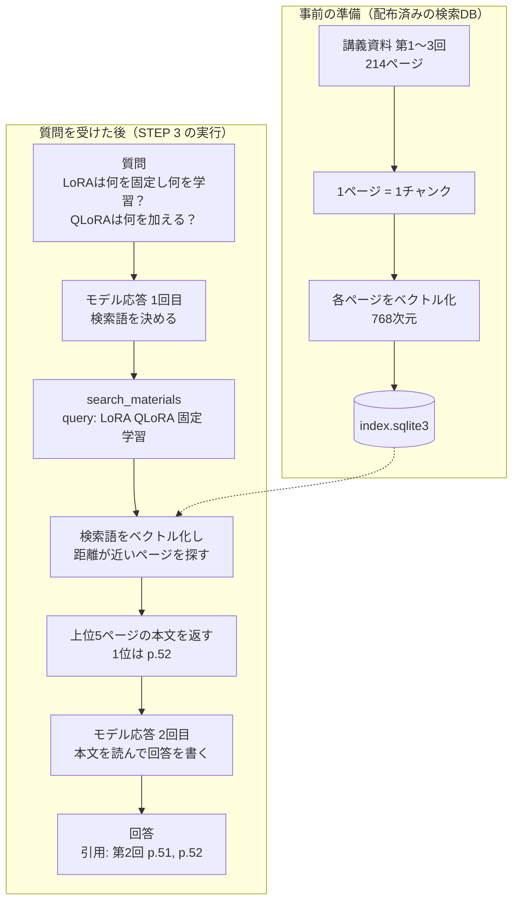

# 第5回 解答

## 演習

- 回答モデル（実行時の`[model]`）：gemini-3.5-flash-lite
- 比較した質問：「第2回の説明では、LoRAは何を固定し何を学習しますか？ QLoRAは何を加えますか？」
- 対象資料（全文投入と他の方式で範囲が違う点も記録）：全文投入は教材JSONの全9資料・438ページ（実行時の表示は入力227,971文字）。ベクトル検索・Tree・Graphは第1〜3回の本講義・214ページ（ページ数は演習資料の記載による）。全文投入だけ対象範囲が広いため、方式間の公平な比較にはなっていない。

### 各方式の結果

| 方式 | 回答の要点・正しさ | 引用ページと根拠 | 時間（秒） | 入力／出力トークン数 | モデル応答回数 | 生成API推定費用（USD） |
|---|---|---|---|---|---|---|
| 全文投入 | 一部正答。答えを直接述べず、「元の重みをどう扱うか」などの問いかけ（ヒント）と参照ページを示した | 第2回 p.51、p.52。参照先は適切 | 9.37 | 117,025／242 | 1 | 0.035712 |
| ベクトル検索 | 正答。LoRAは元の重みWを固定し行列A・Bの差分だけを学習、QLoRAは元の重みを4bitに圧縮、と直接回答 | 第2回 p.51、p.52。本文の記述と一致 | 4.84 | 3,657／195 | 2 | 0.001585 |
| Tree | 正答。内容はベクトル検索と同じ。「付箋」のたとえも引用。1行目に「QLOAR」という綴りの誤りあり | 第2回 p.52。本文の記述と一致 | 6.52 | 9,214／333 | 5 | 0.003597 |
| Graph | 正答。内容はベクトル検索と同じ | 第2回 p.51、p.52。本文の記述と一致 | 13.68（再実行時 18.65） | 5,771／225（再実行時 5,771／211） | 2 | 0.002294（再実行時 0.001711） |

<!-- Graphは3回実行。2回目は「モデルが混み合っています（503）」で回答なし。表は1回目と3回目の値。 -->

- 検索だけを実行して見つかったページと、その本文で確認できたこと：`uv run python -m app.retrieval "LoRA QLoRA 違い"` で第2回の5ページが返った（順に p.52、p.51、p.60、p.47、p.61）。1位の p.52 に「元の重みは固定し、小さな差分だけを学習する（LoRA）。さらに元の重みを4bitに圧縮する（QLoRA）」とあり、答えを支える本文を確認できた。2位の p.51 にも同じ趣旨の説明がある。3〜5位（p.60 演習の説明、p.47 RAGとFTの比較、p.61 演習の進め方）は LoRA／QLoRA の語を含むが、質問の答えは載っていなかった。
- `--trace`で見えたツール呼び出し（ツール名・引数・回数、Treeでたどった目次など）：
  - 全文投入：ツール呼び出しなし。
  - ベクトル検索：`search_materials({'query': 'LoRA QLoRA 固定 学習'})` を1回。検索語は質問文そのままではなく、モデルが作った語だった。
  - Tree：`browse_tree` を4回。引数なし（講義一覧）→ `lec02-main`（第2回）→ `lec02-main-s045`（章「選んだモデルを、いつ・どう直すか」）→ `lec02-main-p052`（本文717文字を取得）。全文を読んだのは p.52 の1ページのみ。
  - Graph：`search_graph({'query': 'LoRA QLoRA 固定 学習'})` を1回。返り値に seeds として p.52 が含まれることを確認した（trace の表示が途中で省略されており、expanded の中身は未確認）。
- 取得した情報が足りなかった例、取得できたのに回答へ使えなかった例：この質問では、情報が足りなかった例は確認できなかった（4方式とも p.52 に到達した）。取得できたのに回答へ十分使えなかった例は全文投入で、p.51・p.52 を参照先として示しながら、答えそのものは述べずヒント形式になった。また、ベクトル検索では5件中3件（p.60、p.47、p.61）が回答に使われず、Graphは入力がベクトル検索の約1.6倍に増えたが引用ページは同じだった。
- 今回の用途に採用したい方式と、その理由・比較条件の限界：この質問のように1ページで根拠がそろう場合は、ベクトル検索を採用したい。正答かつ引用が適切で、時間・入力トークン・推定費用が4方式の中で最も小さかったため（全文投入と比べて入力は約32分の1、推定費用は約23分の1）。ただし限界として、(1) 質問は単一ページ型の1問だけで、複数ページにまたがる質問や資料に答えがない質問は試していない、(2) 各方式の実行はほぼ1回ずつで、回答や時間の揺れを十分に見ていない、(3) 全文投入だけ対象資料の範囲が広い、(4) 推定費用は生成APIのみで、埋め込み・索引構築分を含まない。
- 気づき・疑問：
  - 全文投入だけがヒント形式の回答になった。指示文には共通して「宿題の答えそのものは書かず、考え方のヒントで導く」とあるが、他の3方式は直接回答した。入力の長さが影響しているのか、実行ごとの揺れなのかは、今回の回数では判断できない。
  - Treeは読んだ本文が1ページだけなのに、入力トークンはベクトル検索の約2.5倍だった。モデル応答が5回あり、目次の候補一覧を含むやり取りが積み上がるためと考えられる。
  - Treeで選ばれた章の名前には LoRA という語がなく、モデルは見出しから内容を推測して章を選んでいた。見出しから中身を想像しにくい資料では迷う可能性があるのではないか。
  - Graphは同じ質問・同じ入力トークン数（5,771）でも、時間が13.68秒と18.65秒で、間に503エラーも出た。時間はモデル側の混雑の影響を受けるようで、1回の実行では方式の速さを比べられないと感じた。
  - Graphの推定費用が、入力トークン数が同じなのに 0.002294 と 0.001711 で異なった。出力の差（14トークン）だけでは説明しにくく、費用の計算に trace へ表示されていない要素が含まれているのか疑問。

### 補足：ベクトル検索（STEP 3）の流れ

## 宿題

<!-- 基礎・実装・発展のどれか1つに取り組めば完了です。 -->

- 取り組んだレベル：基礎 / 実装 / 発展
- やったこと（変更したファイル・設定・処理、または設計した取得方法）：
- 比較した質問と、固定した条件（モデル・対象資料など）：
- 結果（変更前後の回答・根拠、`--trace`の出力、時間・トークン数・生成API推定費用など）：
- 改善した例と、残る失敗・制約：
- 気づき・疑問：
